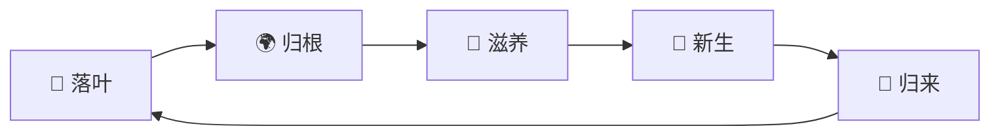

<div align="center">

# 🍂 FoliaRedeunt 🌱

**叶落有时，归来有期。**


> **FoliaRedeunt — Leaves return. 叶会归来。**

</div>

---

## 📑 目录

- [🪪 名称](#name)
- [🌍 我们相信](#believe)
- [🎯 愿景](#vision)
- [📣 口号](#motto)
- [🧩 精神图谱](#map)
- [✨ 一句话记住我们](#remember)

---

## 🪪 名称 <a id="name"></a>

> 🍂 **落叶不是终结，而是回到土地、滋养根系、等待新生。**

我们以 **“落叶归根、循环再生”** 为隐喻，关注人与自然、个体与社群、结束与开始之间的连接。

| 拉丁词 | 含义 | 象征 |
|---|---|---|
| **Folia** | 叶子 | 🍂 坠落、告别、沉淀 |
| **Redeunt** | 归来、返回、重现 | 🌱 回归、修复、重生 |
| **FoliaRedeunt** | 叶会归来 | 🔄 循环与新生 |

> [!TIP]
> **FoliaRedeunt** 不只是一个名字，更是一种看待结束的方式：  
> **结束不是消失，而是换一种形式回来。**

---

## 🌍 我们相信 <a id="believe"></a>

我们相信，世界不是一条单向消耗的直线，而是一个不断循环、修复与再生的系统。

> 🌱 一次失败可以成为经验。  
> 🍂 一段告别可以孕育新的相遇。  
> 🌿 一片落叶可以回到根部，成为下一季新芽的养分。

**FoliaRedeunt** 想做的，是让“归来”发生：

- ✨ 让被遗忘的价值重新被看见；
- 🔗 让断裂的连接重新被修复；
- 🌱 让每一次坠落都拥有重新生长的可能。

---

## 🎯 愿景 <a id="vision"></a>

<div align="center">

### 🌱 让每一次坠落，都成为回归与重生的起点。 🍂

</div>

---

## 📣 口号 <a id="motto"></a>

| 中文 | English |
|---|---|
| **叶落有时，归来有期。** | **Every fall is a return.** |
| **每一次坠落，都是归来。** | **Every fall is a return.** |

> **叶落有时，归来有期。**  
> **Every fall is a return. 每一次坠落，都是归来。**

---

## 🧩 精神图谱 <a id="map"></a>



---

## ✨ 一句话记住我们 <a id="remember"></a>

```text
FoliaRedeunt — Leaves return. 叶会归来。
```

---

<div align="center">

**🍂 叶落有时，归来有期。🌱**

*FoliaRedeunt — Leaves return. 叶会归来。*

</div>
